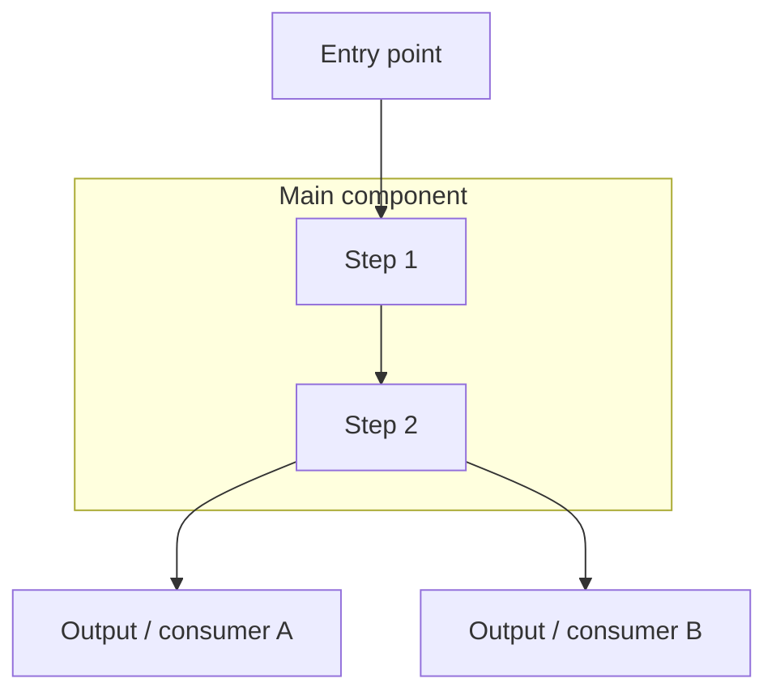

### Reporting

Help the reader understand and review the work. Keep the report proportional to
the task; use the parts that help explain the result.

- **Result:** State what changed or what you found, and why it matters.
  Distinguish confirmed facts from inferences.
- **Understanding:** Explain how the affected parts connect. Use a diagram when
  useful and link important code and tests in reading order, explaining each role.
- **Validation:** Give the commands, scope, and results. Include relevant warnings,
  failed or skipped checks, uncertainty, and unfinished work. Distinguish checks
  you ran from CI results you inspected. Redact secrets from evidence.
- **Delivery:** Say whether the work is local or published. Link confirmed results
  and explain what still needs to happen.

#### Interactive and CI

- **Interactive:** Give brief progress updates and use clickable absolute local
  file links with line numbers. Detailed reports under `{{ .context.TempDir }}`
  are optional.
- **CI:** Keep progress in logs and publish a self-contained result with accessible
  code, PR, check, or artifact links. Follow the workflow's output and publication
  rules. Attribute existing work and checks accurately in PR descriptions.

#### Diagrams

Use flowcharts for flow or dependencies, sequence diagrams for calls over time,
state diagrams for lifecycles, and C4 views for component boundaries. Use Mermaid
on GitHub and confirmed renderers; use ASCII boxes and arrows in fenced `text`
for terminals or uncertain renderers. Show the affected path with real names,
clear boundaries, and labeled arrows. Mark uncertainty explicitly. Trivial edits
can omit a diagram.

See [diagram examples](.go42x/resources/reporting-examples.md) for Mermaid and ASCII
versions of each type. Consult the reference when choosing a diagram.

Example component flow in Mermaid:



#### Full report example

Replace placeholders with verified details and destination-appropriate links.
Adapt the opening for investigation/review findings, omit irrelevant sections,
and select the diagram rendering for the destination.

````markdown
Implemented <change> so that <result or benefit>.

How it works:

<Brief explanation of the flow and key design decisions.>

```text
           +---------------------------+
           |       <Entry point>       |
           |       <file:symbol>       |
           +-------------+-------------+
                         |
                         v
+-------------------------------------------------+
| <Main component>                                |
|                                                 |
|  +-----------------+       +-----------------+  |
|  | <Step 1>        | ----> | <Step 2>        |  |
|  | <purpose>       |       | <purpose>       |  |
|  +-----------------+       +-----------------+  |
|                                                 |
+------------------------+------------------------+
                         |
            +------------+-------------+
            |                          |
            v                          v
+-----------------------+  +-----------------------+
| <Output / consumer A> |  | <Output / consumer B> |
| <file:symbol>         |  | <file:symbol>         |
+-----------------------+  +-----------------------+
```

Review in this order:

1. [<entry point>](<path:line>) — where the behavior starts.
2. [<main implementation>](<path:line>) — how it processes the input.
3. [<consumer or output>](<path:line>) — how the result is used.
4. [<tests>](<path:line>) — which behaviors and failure paths are covered.

Example:

- Input or action: <concrete example>.
- Expected result: <observable behavior>.

Verification:

- Linters passed: <commands and results>.
- Formatters applied: <commands and affected files>.
- Tests executed: <commands or suites and results>.
- <Failed or skipped checks, their reasons, and remaining verification gaps>.

Remaining:

<Known limitations, unresolved issues, or required next steps. Omit if none.>

Delivery:

<Confirmed local or published state, with accessible result links.>
````
