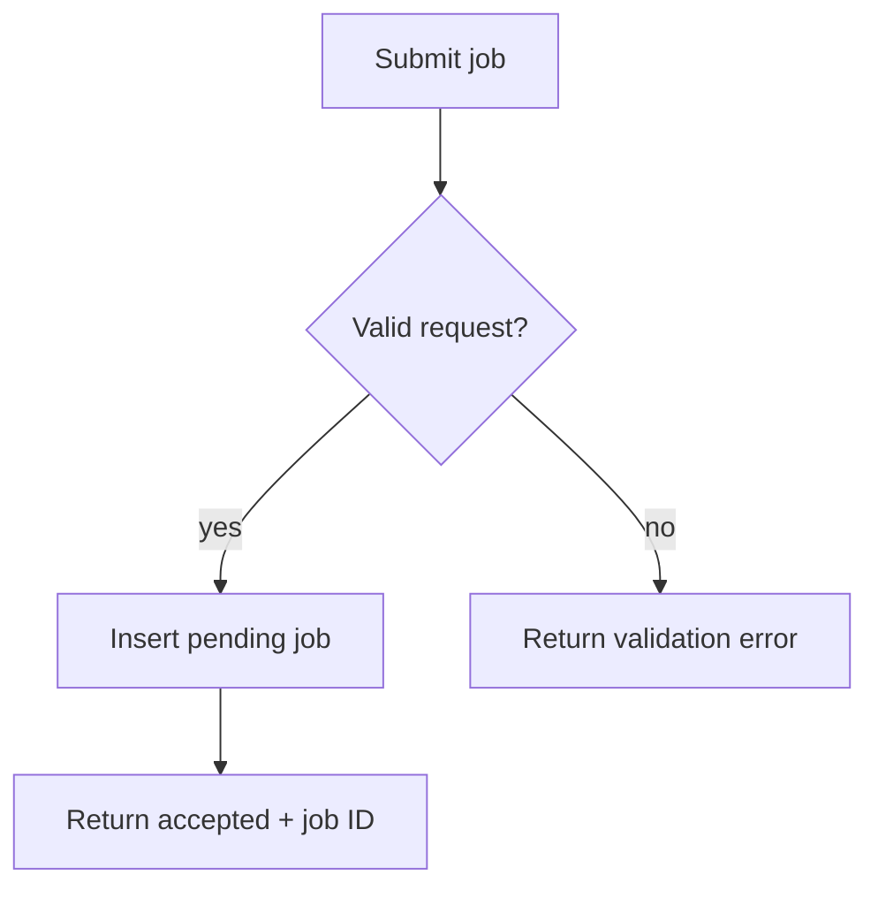
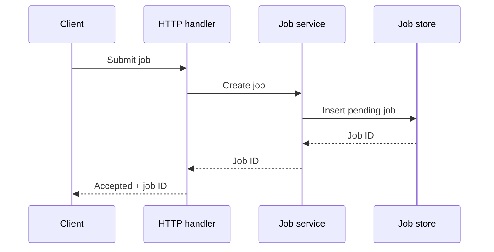
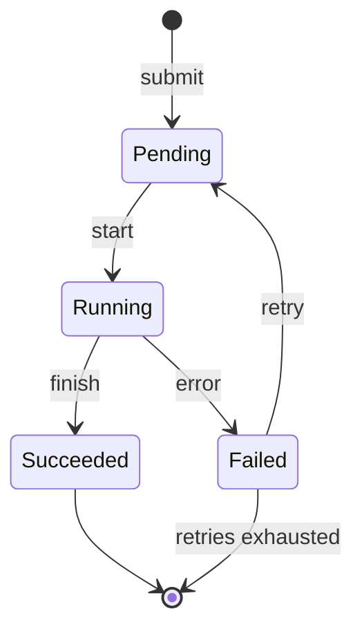
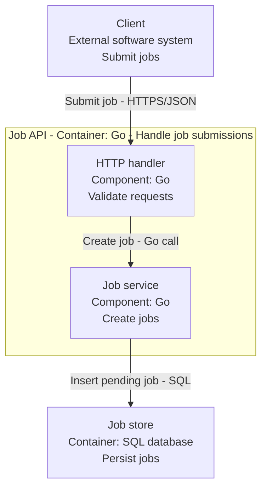

# Reporting diagram examples

Choose the diagram that explains the part of the change a reviewer needs to
understand. These illustrative examples use a background job service. Replace
names, states, and relationships with details verified in the project.

| Type              | Use it to explain                       |
| ----------------- | --------------------------------------- |
| Flowchart         | Processing steps and decisions          |
| Sequence          | Calls between components over time      |
| State             | A lifecycle, including failure or retry |
| C4 component view | Responsibilities and dependencies       |

Each pair uses the same labels and relationships in Mermaid and ASCII. Use
Mermaid where rendering is supported and fenced text in terminals. Explain
unusual notation and keep the diagram focused on the affected behavior.

## Flowchart

Use this for execution order, decisions, and error paths. Here a valid request
creates a pending job; an invalid request returns an error. Braces mark a decision
in the ASCII version, and arrows show execution direction.



```text
[Submit job]
      |
      v
{Valid request?} -- no --> [Return validation error]
      |
     yes
      v
[Insert pending job]
      |
      v
[Return accepted + job ID]
```

## Sequence

Use this when call order and responses matter. This example follows a valid
submission through the HTTP handler and job service to storage. Time runs from
top to bottom; each vertical line belongs to one participant.



```text
     Client                HTTP handler              Job service               Job store
        |                        |                        |                        |
        |------ Submit job ----->|                        |                        |
        |                        |------ Create job ----->|                        |
        |                        |                        |-- Insert pending job ->|
        |                        |                        |<------- Job ID --------|
        |                        |<------- Job ID --------|                        |
        |<- Accepted + job ID ---|                        |                        |
```

## State

Use this to explain a lifecycle and its transitions. After submission, a worker
can start the pending job. Execution either succeeds or fails; a failed job can
retry or stop when retries are exhausted. `(start)` and `(end)` mark lifecycle
boundaries in the ASCII version.



```text
(start) --submit--> [Pending] --start--> [Running]
                        ^                    |
                        |                    +--finish--> [Succeeded] --> (end)
                        |                    |
                        |                    +--error---> [Failed]
                        |                                     |
                        +--------------- retry ---------------+
                                                              |
                                                              +--retries exhausted--> (end)
```

## C4 component view

Use this to explain responsibilities and dependencies inside one container.
Here the Job API container contains two Go components; the client and database
connect to those components. Labels identify types, responsibilities, and protocols.

This C4 view uses ordinary Mermaid flowchart notation. The outer box identifies
the container boundary; the inner boxes identify components. Arrows describe calls
and dependencies, without specifying their execution order.



```text
+----------------------------+
| Client                     |
| External software system   |
| Submit jobs                |
+--------------+-------------+
               | Submit job (HTTPS/JSON)
               v
+-------------------------------------------------------------------+
| Job API [Container: Go]                                           |
| Handle job submissions                                            |
|                                                                   |
|  +----------------------+               +----------------------+  |
|  | HTTP handler         |   Create job  | Job service          |  |
|  | [Component: Go]      |  -----------> | [Component: Go]      |  |
|  | Validate requests    |   (Go call)   | Create jobs          |  |
|  +----------------------+               +-----------+----------+  |
|                                                     |             |
+-----------------------------------------------------+-------------+
                                                      | Insert pending job (SQL)
                                                      v
                                   +-------------------------------------+
                                   | Job store [Container: SQL database] |
                                   | Persist jobs                        |
                                   +-------------------------------------+
```

## References

- [Mermaid flowcharts](https://mermaid.js.org/syntax/flowchart.html)
- [Mermaid sequence diagrams](https://mermaid.js.org/syntax/sequenceDiagram.html)
- [Mermaid state diagrams](https://mermaid.js.org/syntax/stateDiagram.html)
- [C4 component diagrams](https://c4model.com/diagrams/component)
- [C4 notation guidance](https://c4model.com/diagrams/notation)
