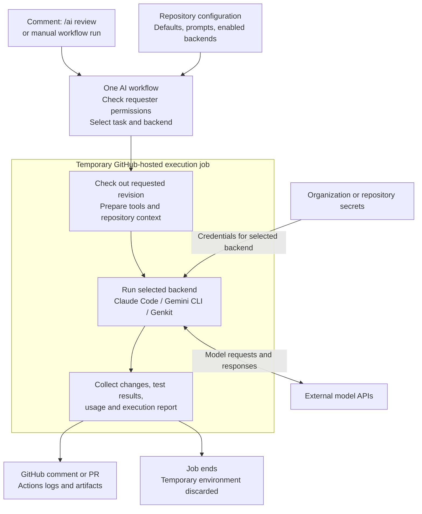

# Agentic workflow

## Current setup

Claude and Gemini workflows use the repository-local
[AI preparation action](../../.github/actions/ai-prepare-env/action.yml). The preparation actions are maintained in
go42x and copied into this repository.

Automatic PR description generation is currently disabled: the former summary action and workflow have been removed.
A replacement using GitHub Agentic Workflows is planned and has not been implemented.

## Planned execution

The diagram describes the intended workflow; the current Claude and Gemini integrations remain separate workflows.

